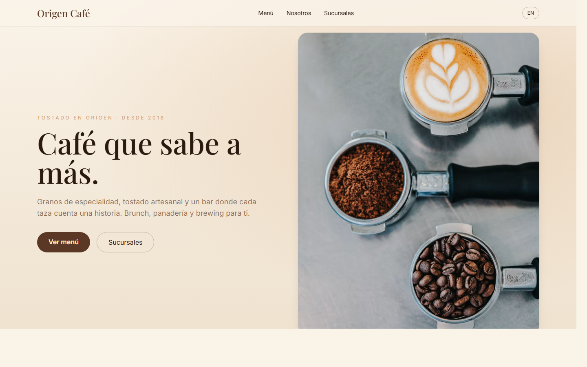

# Origen Café · Coffee Shop Landing

[](https://frank-merti.github.io/portfolio-landings/09-cafe/)
[](LICENSE)

Specialty coffee roaster landing: menu, origins, locations and ES/EN language switch.

**Landing de tostadores de café de especialidad: menú, orígenes, sucursales y cambio de idioma ES/EN.**



---

## ES

### Funcionalidad
- Hero con degradado cálido y llamada a la acción.
- Sección "Del grano a la taza" con métricas (orígenes, sucursales, recetas).
- Menú en 6 tarjetas (café, brunch y panadería) con precios.
- Sucursales con horarios y bloque inverso de color.
- Conmutador ES/EN con persistencia en `localStorage`.

### Stack
HTML5 semántico · Tailwind CSS (CDN) · JavaScript vanilla · Google Fonts

### Ejecutar
```bash
cd 09-cafe
npx serve 09-cafe
```

### Qué aprendí
- Una paleta cálida (crema, espresso, oro) genera una marca coherente sin necesidad de imágenes de marca.
- Alternar secciones claras y oscuras con `bg` invertido crea ritmo visual sin JavaScript.
- Mantener el mismo esqueleto de landing entre proyectos permite iterar más rápido y comparar diseños.

## EN

### Features
- Hero with warm gradient and call to action.
- "From bean to cup" section with metrics (origins, locations, recipes).
- Menu with 6 cards (coffee, brunch, bakery) and pricing.
- Locations with opening hours and an inverted color block.
- ES/EN switch persisted in `localStorage`.

### Stack
Semantic HTML5 · Tailwind CSS (CDN) · Vanilla JavaScript · Google Fonts

### Run
```bash
cd 09-cafe
npx serve 09-cafe
```

### What I learned
- A warm palette (cream, espresso, gold) creates a coherent brand without custom brand assets.
- Alternating light and inverted sections creates visual rhythm without JavaScript.
- Reusing the same landing skeleton across projects speeds up iteration and makes designs comparable.

## Licencia
[MIT](LICENSE) © 2026 Francisco Merti
